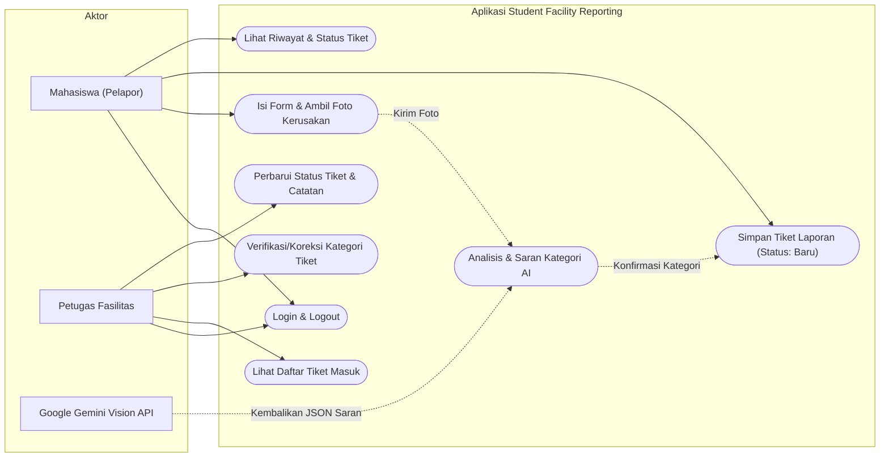
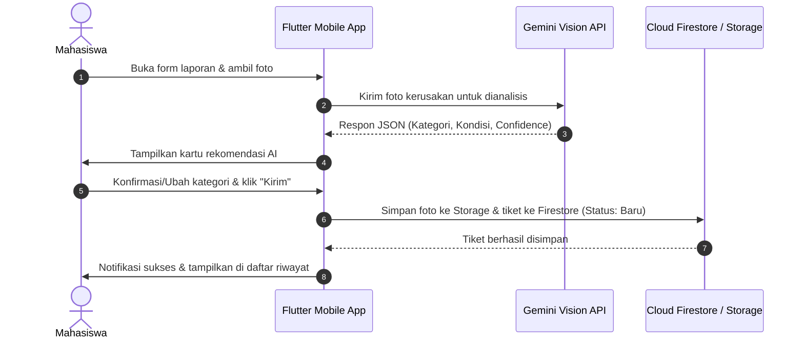

# Diagram Alur & Use Case — Student Facility Reporting

Dokumen ini memvisualisasikan interaksi aktor (Mahasiswa, Petugas Fasilitas, dan Sistem AI Vision) dengan sistem.

---

## 📊 Use Case Diagram (Mermaid)

---

## 🔄 Alur Pelaporan Mahasiswa (User Flow)

